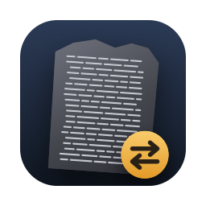

# Inversa

Inversa runs Linux programs on Apple silicon Macs, no VM. ARM64 programs run natively, loaded by [Klepton](https://github.com/shinyquagsire23/Klepton). x86-64 programs run through [FEX](https://github.com/FEX-Emu/FEX), which is itself built for Linux ARM64 and loaded the same way. Underneath both is Inversa's own kernel layer (`kernel/`), the Linux syscall ABI implemented on top of Darwin.

```
inversa run <program> [args...]
inversa probe <program>          # load it, list what doesn't resolve, run nothing
```

## Building

You need Xcode's command-line tools and Homebrew.

```
brew install llvm lld ninja cmake vulkan-headers
tools/setup.sh     # FEX and Klepton at their pinned commits, with patches/ applied
make sysroot       # Debian arm64 sysroot for cross-building FEX
make fex           # build/lib/libFEXInversa.so
make               # build/Inversa.app
make rootfs        # build/rootfs/x86_64 (bash, coreutils) and the arm64 libraries FEX links against
make tests         # tests/build/hello_x64
```

x86-64 code expects 4K pages, and Apple silicon Macs use 16K. macOS hands out 4K pages only to processes with the cross-architecture entitlement, so the app is signed with a Developer ID (`SIGN_ID`) and a provisioning profile that grants it (`PROFILE`). To use your own, set `BUNDLE_ID` and change the application identifier in `host/entitlements.plist` to match your profile. Without a profile the app is signed ad hoc: ARM64 programs still run, x86-64 ones refuse to start, and `probe` works for both.

If the keychain lookup fails the build falls back to ad hoc without stopping, so check what you got:

```
codesign -d --entitlements - build/Inversa.app
```

## How it works

`Contents/MacOS/inversa` (`host/launch.c`) is a small launcher that starts `inversa-core` in a 4K-page process in one spawn. The core (`host/inversa.c`) looks at the ELF machine type. For an ARM64 program, Klepton loads the program itself. For x86-64, Klepton loads `libFEXInversa.so` instead and FEX is told the CPU's features (`host/cpu.c`) and where the x86-64 root is.

Guest code links against a glibc ABI built over Darwin's libc (`loader/glibc`). Raw syscalls end up in `inv_syscall` (`kernel/kernel.c`): FEX makes its own syscalls, and passes on the guest's, through `syscall()`, because `patches/fex-inversa.patch` takes out its `svc` instructions. Calls that mean the same thing as a libc function go straight to that function. The rest are written out in `kernel/`: memory, file lookups inside a root, stat layouts, futexes, signals, fork and exec, ioctls.

After `fork` the child rebuilds Klepton's mutexes and resets its JIT state before running guest code. When a guest execs another Linux program, that becomes another `inversa run`, spawned straight into 4K pages.

There's also an experimental ARM64 loader that runs a program on its own Linux `ld.so` and glibc (`kernel/linux.c`, `INVERSA_ARM64_LINUX=1`). It wants an ARM64 root at `build/rootfs/aarch64` or `INVERSA_ROOTFS`.

## Layout

| | |
|---|---|
| `host/` | the launcher and `inversa` command, CPU feature registers for FEX, `Info.plist`, entitlements |
| `kernel/` | the Linux syscall layer (`kernel.h` lists what each file provides); `syscall_names.h` is generated by `tools/gen_syscalls.py` |
| `loader/` | the glibc ABI over Darwin, ELF TLS, JIT memory, crash reports, Steam paths |
| `third_party/` | FEX and Klepton as submodules; `patches/` holds Inversa's changes to them |
| `tests/` | `check.py`, the regression set, and a static x86-64 test program |
| `bench/` | a CPU benchmark run natively, under Rosetta, Inversa and Wine |
| `docs/` | the icon at 256 px for this page, copied from `build/Inversa.iconset` |
| `tools/` | Debian root and sysroot fetcher, cross toolchain file, icon, FEX symboliser, `safe_run.py` |

## Testing

```
python3 tests/check.py              # all of it
python3 tests/check.py pipe subst   # some of it
```

Every case runs under `tools/safe_run.py`, which caps CPU time and kills the whole process group when the run ends or times out. It's worth using for anything experimental too:

```
python3 tools/safe_run.py --timeout 10 --log /tmp/inversa.log -- build/Inversa.app/Contents/MacOS/inversa run <program>
```

The watchdog has to be able to signal its child, so don't run it inside a restrictive sandbox. It won't save you from a kernel panic, though: running under lldb with both `INVERSA_NO_4K` and `INVERSA_NO_CRASH_HANDLER` set has panicked a Mac, so don't.

One known bug: a second `fork` that runs bash code without an `exec` hangs on its pipe, as in `( echo a ); echo $(echo b)`. `check.py` lists those cases as `known`.

## Benchmarks

`bench/run.py` times `bench/cpubench.c` natively, under Rosetta, under Inversa and, if you point it at them, under Wine. It expects the binaries in `build/bench`. Building the Linux x86-64 one needs an x86-64 sysroot (`python3 tools/fetch_rootfs.py amd64 build/sysroot-x86_64 libc6-dev libgcc-14-dev linux-libc-dev`), and the Windows ones need llvm-mingw.

## Debugging

| Variable | Effect |
|---|---|
| `INVERSA_STRACE=1` | each syscall the kernel layer serves |
| `INVERSA_STRACE=names` | also list forwarded syscalls that have no libc function behind them |
| `INVERSA_GSTRACE=1` | the guest's x86-64 syscalls, as FEX sees them (`INVERSA_GSTRACE_FILE` to write them to a file) |
| `INVERSA_TIME=1` | milliseconds since the first exec at each start-up stage |
| `INVERSA_IMAGES=1` | the address range of every loaded image, for symbolising `sample` output |
| `INVERSA_REPORT=1` | unresolved and null weak imports, as `probe` prints them, before running |
| `INVERSA_FAULT_TRACE=1` | the first 16 faults handed to the guest's signal handlers, per process |
| `MVR_CRASH_REGS=1`, `MVR_CRASH_STACK=1` | more registers and stack in crash reports |
| `MVR_TRACE=1` | trace some of the glibc layer's calls (Klepton fallbacks, readlink, semget) |
| `INVERSA_NO_4K=1` | stay in 16K pages |
| `INVERSA_NO_CRASH_HANDLER=1` | leave crashes to the system |
| `INVERSA_FEX` | load a different `libFEXInversa.so` |
| `INVERSA_VULKAN_DRIVER=moltenvk` | use MoltenVK rather than KosmicKrisp |
| `INVERSA_ARM64_LINUX=1`, `INVERSA_ROOTFS` | the experimental ARM64 loader and its root |

`tools/fexsym.py <offset>...` turns offsets in `libFEXInversa.so` into FEX function names (it uses Homebrew's `llvm-nm`, or `LLVM_NM`).

## Licence

Copyright (C) 2026 Toby Fox. Inversa is free software under the GNU General Public License, version 3; see [LICENSE](LICENSE).

## Credits

[FEX](https://github.com/FEX-Emu/FEX) and [Klepton](https://github.com/shinyquagsire23/Klepton) are both MIT licensed. The guest roots and sysroots are unpacked from Debian packages, each under its own licence.
